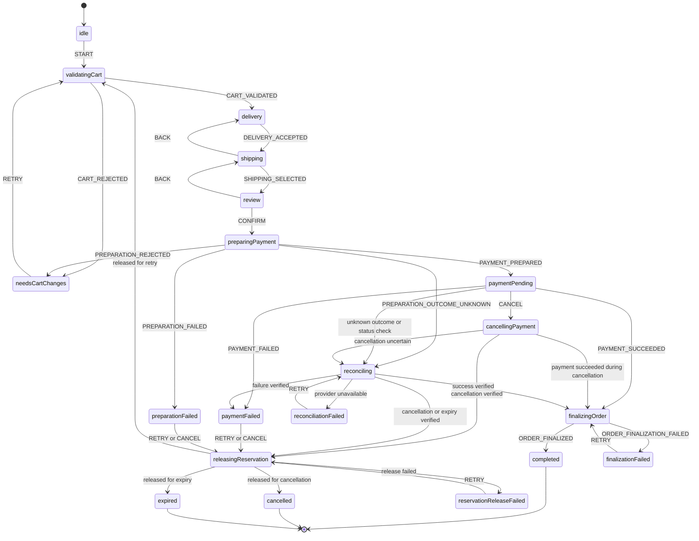
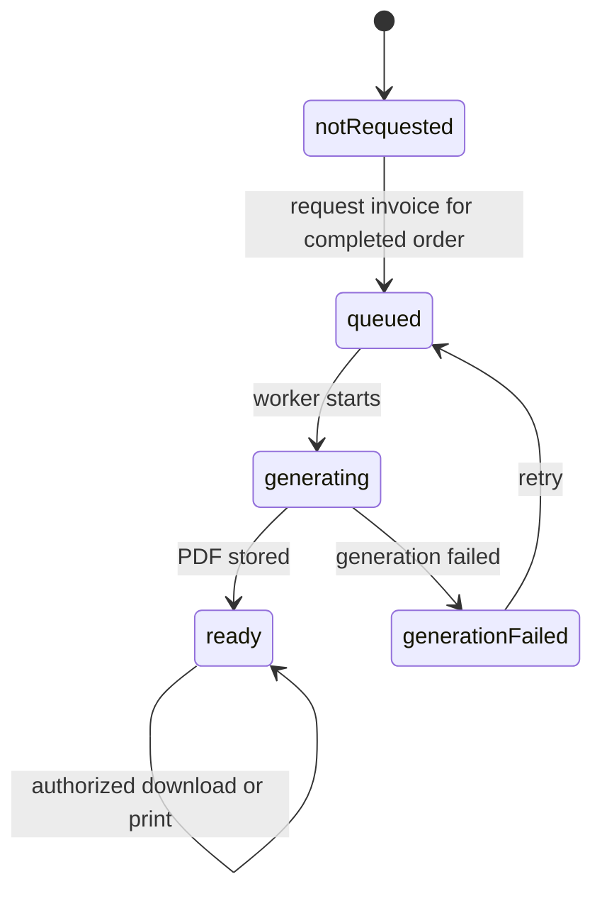

# Checkout implementation roadmap

## Milestone 1: state machine and transition logs

Implemented: a typed XState 5 model in `src/checkout/checkout.machine.ts`, transition
logs, tests and a deterministic CLI demo. This is a model of the intended workflow,
not a working checkout. It is not wired into AppModule, a public endpoint or the cart UI.

All business operations are **log-only placeholders**, including validation,
reservations, payment preparation, order writes, cart cleanup and invoice work.
Sending `PAYMENT_SUCCEEDED` in the demo simulates a trusted server outcome; it does
not verify or charge a real payment. `completed` in this demo creates no order.
There is no PDF generation, email delivery or database persistence in milestone 1.

```sh
npm run checkout:demo                 # successful simulated checkout
npm run checkout:demo -- retry       # rejection, new attempt, stale-result rejection
npm run checkout:demo -- cancel      # confirmed cancellation, then reservation release
npm run checkout:demo -- expiry      # verified expiry, then reservation release
npm run checkout:demo -- reconciliation
npm run test:checkout
```

The demo compiles only checkout files into `.tmp/checkout-demo`, so it does not
clean `dist` or interfere with a running Nest development watcher. Logs contain
checkout identifiers, state/event names and the **planned** operation; they do not
include buyer identities, addresses, contact details or provider payloads.

### State model



Before payment preparation, CANCEL can finish immediately because no reservation
or provider attempt exists. During preparation it is deliberately unavailable;
the UI will wait for a preparation outcome. Once payment is pending, cancellation
requires provider confirmation and reservation release. A status check is not
proof of expiry; only a verified provider result permits the expiry path.

`PREPARATION_REJECTED` means preparation rolled back before creating a live attempt
or reservation. Definitive preparation failure may leave a reservation to release.
Unknown preparation outcomes must carry the persisted attempt reference and be
reconciled instead of blindly retried. Every new attempt must have a fresh durable
ID; payment results are accepted only for the current attempt.

`ORDER_FINALIZED` will mean that the SQL order/stock/outbox transaction committed.
A paid order cannot simply be cancelled when this write fails. Its safe retry
must be idempotent. Permanent finalization failure and a payment arriving after
confirmed expiry will need compensation/refund handling in later milestones.

Outcome events will be produced by trusted services and verified callbacks. The
browser will submit commands such as confirm/cancel; it will never be allowed to
assert payment success, reservation release or successful order persistence.

### Persistence boundary

The tests demonstrate JSON serialization/restoration of the model. That is **not**
durable execution or exactly-once payment/stock behavior. Later milestones must
persist snapshots with a machine version, an aggregate revision and an event audit
trail. Concurrency control and idempotency belong in SQL. Pending effects must be
written to an outbox and recovered by workers; restored entry actions must not be
assumed to replay. No in-memory actor or timer will be the sole record of an order.

References: [XState actions/logging](https://stately.ai/docs/actions) and
[XState persistence](https://stately.ai/docs/persistence).

## Incremental commits

Each milestone should have its own reviewed, tested commit. Milestone 1 is the
only implementation in this change; subsequent items are planned work.

1. [x] **Model checkout states and logged transitions.** Typed outcomes, payment
   attempt correlation, explicit release/finalization acknowledgements, demo and tests.
2. [ ] **Persist checkout sessions and expose buyer commands.** SQLite snapshots,
   machine versions, optimistic revisions, session ownership, same-origin guards,
   idempotency keys and cross-device/restart recovery.
3. [ ] **Add delivery, shipping and review UI.** Handlebars/SurveyJS, structured
   addresses, seller-grouped shipping, integer-cent EUR quotes and explicit
   re-review when prices or availability change. An empty/invalid cart or a product
   without an assigned seller cannot proceed.
4. [ ] **Add pending orders and stock reservations.** Parent order plus seller
   orders, immutable item/address/price snapshots, reservation deadlines, atomic
   availability checks and seller stock corrections that respect reservations.
   Carts continue not to reserve stock.
5. [ ] **Implement simulated payments and atomic finalization.** Success/rejection/
   unknown outcomes, verified expiry/cancellation, duplicate notifications,
   stock deduction and order/outbox commit together. Use the existing
   `withStockTransaction`/`deductStock` boundary. Schedule idempotent MongoDB cart
   cleanup that preserves concurrent edits, plus background reconciliation.
6. [ ] **Generate and store invoice PDFs.** Separate post-payment workflow,
   durable document records, unique numbering, immutable order-based totals and
   private PDF storage. For this multi-seller shop, plan one invoice per seller
   order and a separate consolidated purchase summary. Confirm the issuer,
   invoice fields, tax calculation and numbering rules before implementing them.
7. [ ] **Deliver invoices and provide download/print UI.** BullMQ email jobs via
   the existing email configuration, retryable delivery, buyer download and an
   explicit Print button using the PDF viewer. Check access against the buyer,
   relevant seller or admin; never use public product-media URLs for invoices.
8. [ ] **Integrate a real payment provider and finish recovery flows.** Verified
   callbacks, provider reconciliation, late/duplicate events, compensation/refunds
   and operational recovery. Simulated payment remains available for tests.

## Invoice subworkflow (design only)

A completed checkout must remain completed even if generating or emailing its
invoice fails. Run document work separately after the order's committed success.



Email delivery has its own queued/sending/sent/failed state with retries. It can
start only after the PDF exists. Retrying email reuses the stored PDF, not a new
invoice number. The generation job is idempotent by seller-order/document type;
repeated requests reuse the same issued document. A changed or refunded order
must not silently overwrite an already issued PDF.

Phone-only accounts can download and print their documents without adding an
email address. Email delivery requires a verified email destination; the absence
of one must not block checkout. Billing details, when needed, will be collected
and snapshotted with the order rather than read later from a mutable profile.

PDF generation and email will be separate outbox/job effects, not synchronous
work inside the payment or inventory transaction. Printing is initiated by the
buyer; there will be no automatic printer access. Invoice access and failure/
retry paths will be tested when their milestones are implemented.
