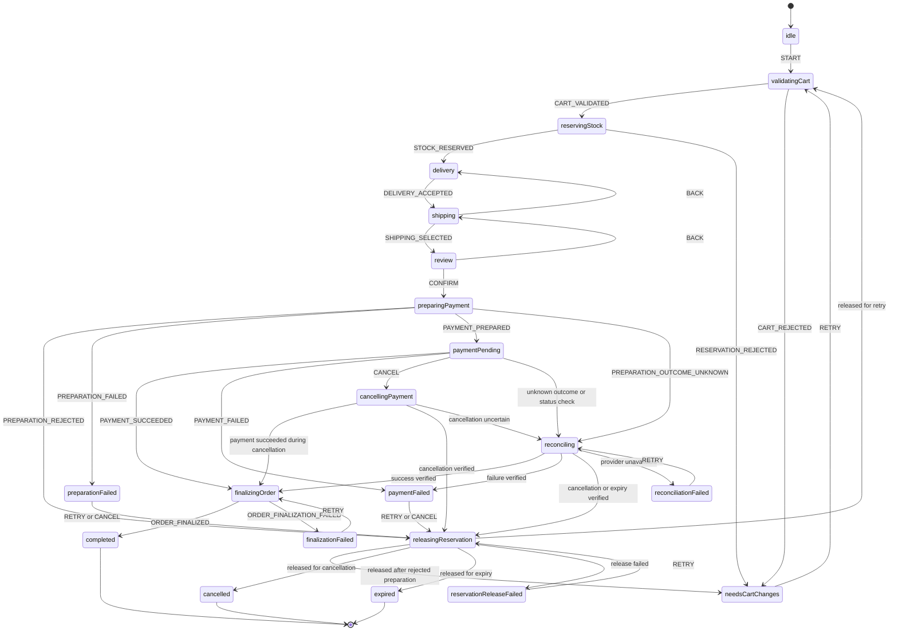
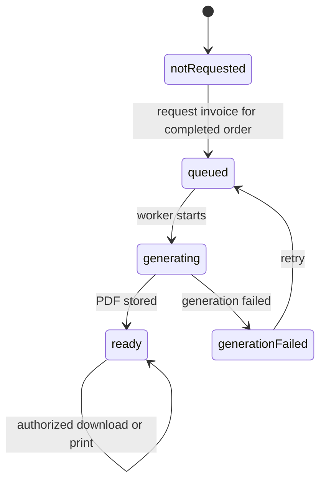

# Checkout implementation roadmap

## Step 2: live cart validation, stock reservations and UI

Implemented: `/cart` now links to `/checkout`. Authenticated buyers can review
server-calculated item prices, reserve the selected cart for 15 minutes, resume
that hold on another device, and release it. Delivery, shipping and review are also implemented (see the next milestone below).
Payment, order placement, fulfillment and invoices remain future work.

The server reads the buyer's MongoDB cart, validates every product/quantity/price
and assigned seller, and compares a canonical quote hash before reserving. The
browser cannot supply a buyer identity, prices, line items or machine events.
A changed cart or price requires another review. Unavailable items produce clear
issues and no partial reservation. The hash is a stale-quote check, not an
alternative to server-side validation or authorization.

SQLite stores checkout sessions, immutable reviewed item snapshots, revisions,
machine versions/snapshots and reservation lines. Reservations leave physical
stock unchanged. Availability is physical stock minus active, unexpired holds.
The full reservation is committed in one transaction using the existing
product/media write serialization. Duplicate clicks reuse one active checkout per
buyer and do not extend its original deadline. Cart edits do not change its snapshot.

Reservation expiry is effective directly in SQL availability queries, even while
the app is stopped; checkout requests also mark expired sessions and clean up
reservation rows. No in-memory timer or queue job is required to free availability.
The UI countdown is informative; the server deadline is authoritative.

Sellers cannot correct stock below active holds or delete a reserved product
(including an admin deletion). Restocking remains allowed. Buyers see availability
excluding other buyers' holds, while their own reserved units remain available
in their saved cart. Adding to the cart still creates no reservation.

The XState flow now includes `validatingCart -> reservingStock -> delivery`.
Only after SQL reservation lines are written is `STOCK_RESERVED` applied and the
snapshot saved. No public endpoint accepts arbitrary machine events. Cancellation
acknowledges release before entering `cancelled`; expiry enters `expired`.
Only successfully reserved checkouts are persisted; validation failures create no
session or hold. Event auditing for the later full order/payment workflow remains
planned work.

| Method | Route | Body / result |
| --- | --- | --- |
| GET | `/checkout` | Protected Handlebars page |
| GET | `/checkout/data` | Current quote/issues and the buyer's active checkout |
| POST | `/checkout/reservations` | `{ "quoteHash": "..." }`; create/reuse a hold |
| GET | `/checkout/:id` | Own reservation status; foreign IDs return 404 |
| DELETE | `/checkout/:id` | `{ "revision": 1 }`; release an unchanged hold |
| POST | `/checkout/:id/delivery` | Address/contact fields plus `revision`; save and go to shipping |
| POST | `/checkout/:id/shipping` | `{ "revision": 2, "method": "standard" }`; calculate and save shipping, go to review |
| POST | `/checkout/:id/back` | `{ "revision": 3 }`; review → shipping or shipping → delivery |

All routes require the buyer role, support session cookies or bearer tokens, and
use `Cache-Control: no-store`. Mutations enforce same-origin protection and DTO
whitelists. Authentication and account ownership are determined on the server.

Development synchronization creates the tables. Production must apply
`migrations/003-checkout-reservations.sql`, then
`migrations/004-checkout-details.sql` before deploying this version. Apply each once;
existing sessions remain usable with null delivery/shipping fields.
`npm run test:checkout` runs model and browser tests;
`npm run test:checkout:integration` builds and runs SQL/reservation and HTTP tests.
Stop development watchers before invoking build-based test commands.

## Delivery, shipping and review milestone

Implemented in the **checkout phase**, using the existing persisted XState
`delivery -> shipping -> review` states. Server commands validate and save business
data and the matching machine snapshot in the same SQL transaction. The browser
cannot send XState events or advance straight to payment. Existing snapshot
state names remain compatible; no machine-version migration is needed.

The owner-only response explicitly distinguishes `phase: "checkout"`,
`paymentStatus: "not_started"` and `fulfillmentStatus: "not_started"`. These last
two are milestone boundary markers, not implemented payment/fulfillment engines.
Later payment status and seller shipment/fulfillment status will have their own
durable records. Choosing a shipping method now does **not** create a shipment,
charge money, finalize an order or generate an invoice.

Delivery requires a full name, street/house-number line, five-digit postal code,
city, country `DE`, and **at least one valid email or international phone number**.
Every supplied contact must be syntactically valid. Contact details here are for
this checkout, do not modify account contacts or login credentials, and are not
newly OTP-verified. Future invoice emails must still use a verified destination.
Phone-only buyers can continue without an email. Country support currently stops
at Germany; address validation checks format, not actual deliverability.

`src/checkout/shipping.ts` is the local demo tariff adapter: standard €4.99 or
express €9.99 **per distinct seller**. One method is applied to all seller
shipments. Estimates are explicitly demo estimates, not carrier guarantees. Rates
are calculated solely on the server from the reserved item/seller snapshot. For
two sellers standard shipping is €9.98. The selected quote, its per-seller fees,
and the delivery details are saved in SQLite; review displays items, delivery,
shipping by seller, subtotal, shipping and total using integer cents. It uses the
existing catalog prices; no new tax, discount, billing-address or payment logic
is introduced. A future carrier adapter can replace `shippingOptions` without
moving pricing into the browser.

Back navigation allows review → shipping → delivery. Saving delivery again clears
any shipping selection and requires another selection/review. Every write includes
the last observed revision; concurrent/stale edits fail with 409. The UI refreshes
the server version on a conflict, so the buyer must review the saved state before
resubmitting. Repeating a delivery/shipping write with an old revision does not
apply twice; reload recovers the already committed state after a lost response.
The original 15-minute deadline never extends while filling in forms or going back.
Expiry and cancellation work in all three states and release the same stock hold.

The Handlebars page uses accessible native forms with browser TypeScript for
commands, native Enter submission, validation and focus on the next heading.
Background polling preserves unsaved input/focus when the revision is unchanged.
A newer revision from another device reloads the saved details with a notice.
Private form/review values are cleared when leaving the page or after session
expiry. Own delivery data is deliberately exempt from the global PII mask, so
editing never sends a masked email/phone back to the server; ownership guards and
`no-store` headers protect the endpoints. Addresses/contacts are not logged.

The last screen deliberately stops at review with “Payment coming next”. The next
milestone is creating pending parent/seller orders from these snapshots, then
starting the separate payment flow. Fulfillment follows a confirmed order.

## Milestone 1: state machine and transition logs

Implemented: a typed XState 5 model in `src/checkout/checkout.machine.ts`, transition
logs, tests and a deterministic CLI demo. This is a model of the intended workflow,
not a payment implementation. The step-2 server coordinates real validation and
reservation operations around the model; the CLI remains entirely simulated.

In the CLI demo, all business operations are **log-only placeholders**, including validation,
reservations, payment preparation, order writes, cart cleanup and invoice work.
Sending `PAYMENT_SUCCEEDED` in the demo simulates a trusted server outcome; it does
not verify or charge a real payment. `completed` in this demo creates no order.
There is no PDF generation, email delivery or database persistence in milestone 1.

```sh
npm run checkout:demo                 # successful simulated checkout
npm run checkout:demo -- retry       # rejection, new attempt, stale-result rejection
npm run checkout:demo -- cancel      # confirmed cancellation, then reservation release
npm run checkout:demo -- expiry      # verified expiry, then reservation release
npm run checkout:demo -- reconciliation
npm run test:checkout
```

The demo compiles only checkout files into `.tmp/checkout-demo`, so it does not
clean `dist` or interfere with a running Nest development watcher. Logs contain
checkout identifiers, state/event names and the **planned** operation; they do not
include buyer identities, addresses, contact details or provider payloads.

### State model



Before stock reservation, CANCEL can finish immediately. Once items are held,
cancellation must release the reservation before finishing. During preparation it is deliberately unavailable;
the UI will wait for a preparation outcome. Once payment is pending, cancellation
requires provider confirmation and reservation release. A status check is not
proof of expiry; only a verified provider result permits the expiry path.

`PREPARATION_REJECTED` means order/payment preparation rolled back before a live
payment attempt was created. The earlier cart reservation must still be released
before returning to cart corrections. Definitive preparation failure also releases
the reservation before retry or cancellation.
Unknown preparation outcomes must carry the persisted attempt reference and be
reconciled instead of blindly retried. Every new attempt must have a fresh durable
ID; payment results are accepted only for the current attempt.

`ORDER_FINALIZED` will mean that the SQL order/stock/outbox transaction committed.
A paid order cannot simply be cancelled when this write fails. Its safe retry
must be idempotent. Permanent finalization failure and a payment arriving after
confirmed expiry will need compensation/refund handling in later milestones.

Outcome events will be produced by trusted services and verified callbacks. The
browser will submit commands such as confirm/cancel; it will never be allowed to
assert payment success, reservation release or successful order persistence.

### Persistence boundary

The tests demonstrate JSON serialization/restoration, and step 2 persists snapshots,
machine versions and revisions for the reservation lifecycle. That is **not**
durable payment execution or exactly-once order behavior. Later order/payment
work will add an event audit trail and extend command concurrency controls. Concurrency control and idempotency belong in SQL. Pending effects must be
written to an outbox and recovered by workers; restored entry actions must not be
assumed to replay. No in-memory actor or timer will be the sole record of an order.

References: [XState actions/logging](https://stately.ai/docs/actions) and
[XState persistence](https://stately.ai/docs/persistence).

## Incremental commits

Each milestone is kept reviewable and tested. You commit and push it yourself on main;
the agent does not create commits or branches. Milestone 1 is the
initial model implementation. Step 2 now adds real validation, reservations and
a buyer UI; delivery/shipping/review is now complete too. Subsequent items remain planned.

1. [x] **Model checkout states and logged transitions.** Typed outcomes, payment
   attempt correlation, explicit release/finalization acknowledgements, demo and tests.
2. [x] **Validate carts, reserve stock and add a buyer UI.** SQLite snapshots,
   fixed deadlines, idempotent reservation requests, session ownership, cancellation
   revisions and cross-device/restart recovery. Full order event auditing and
   payment-command concurrency remain part of the later order/payment implementation.
3. [x] **Add delivery, shipping and review UI.** Handlebars/native forms, structured
   addresses, seller-grouped shipping, integer-cent EUR quotes and explicit
   review, saved delivery/shipping and revision-checked back navigation. An empty/invalid cart or a product
   without an assigned seller cannot proceed.
4. [ ] **Add pending orders and extend reservations into the order workflow.** Parent order plus seller
   orders, immutable item/address/price snapshots, reservation deadlines, atomic
   availability checks and seller stock corrections that respect reservations.
   Carts continue not to reserve stock.
5. [ ] **Implement simulated payments and atomic finalization.** Success/rejection/
   unknown outcomes, verified expiry/cancellation, duplicate notifications,
   stock deduction and order/outbox commit together. Use the existing
   `withStockTransaction`/`deductStock` boundary. Schedule idempotent MongoDB cart
   cleanup that preserves concurrent edits, plus background reconciliation.
6. [ ] **Generate and store invoice PDFs.** Separate post-payment workflow,
   durable document records, unique numbering, immutable order-based totals and
   private PDF storage. For this multi-seller shop, plan one invoice per seller
   order and a separate consolidated purchase summary. Confirm the issuer,
   invoice fields, tax calculation and numbering rules before implementing them.
7. [ ] **Deliver invoices and provide download/print UI.** BullMQ email jobs via
   the existing email configuration, retryable delivery, buyer download and an
   explicit Print button using the PDF viewer. Check access against the buyer,
   relevant seller or admin; never use public product-media URLs for invoices.
8. [ ] **Integrate a real payment provider and finish recovery flows.** Verified
   callbacks, provider reconciliation, late/duplicate events, compensation/refunds
   and operational recovery. Simulated payment remains available for tests.

## Invoice subworkflow (design only)

A completed checkout must remain completed even if generating or emailing its
invoice fails. Run document work separately after the order's committed success.



Email delivery has its own queued/sending/sent/failed state with retries. It can
start only after the PDF exists. Retrying email reuses the stored PDF, not a new
invoice number. The generation job is idempotent by seller-order/document type;
repeated requests reuse the same issued document. A changed or refunded order
must not silently overwrite an already issued PDF.

Phone-only accounts can download and print their documents without adding an
email address. Email delivery requires a verified email destination; the absence
of one must not block checkout. Billing details, when needed, will be collected
and snapshotted with the order rather than read later from a mutable profile.

PDF generation and email will be separate outbox/job effects, not synchronous
work inside the payment or inventory transaction. Printing is initiated by the
buyer; there will be no automatic printer access. Invoice access and failure/
retry paths will be tested when their milestones are implemented.
